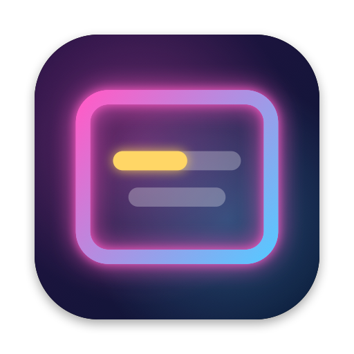
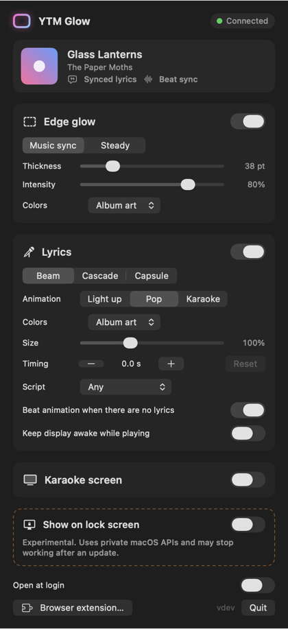
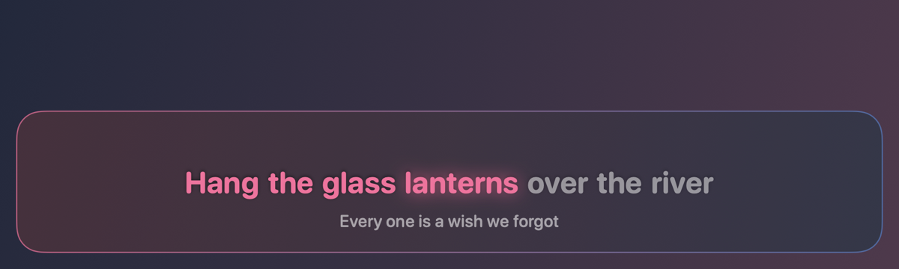
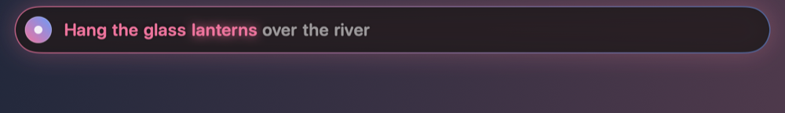
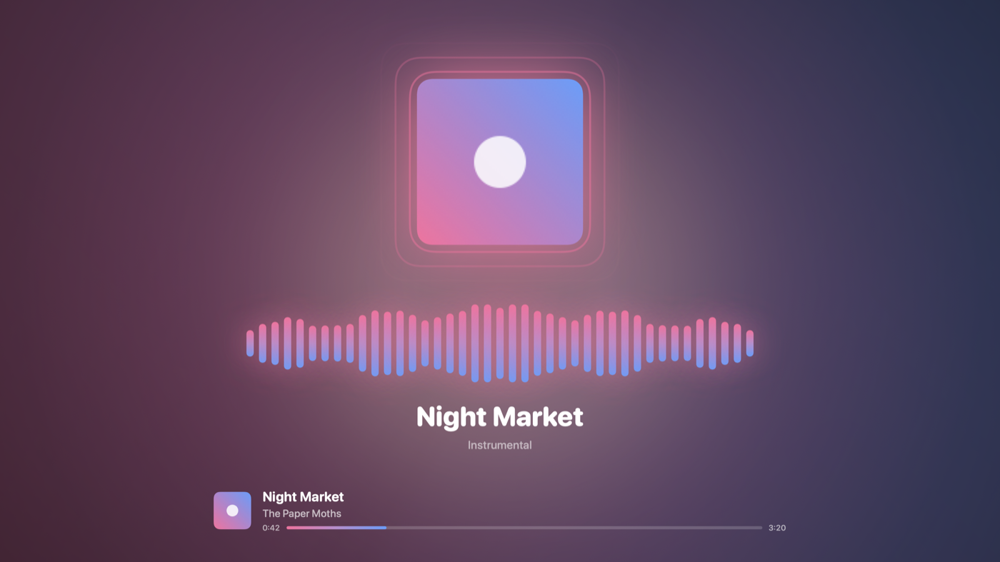
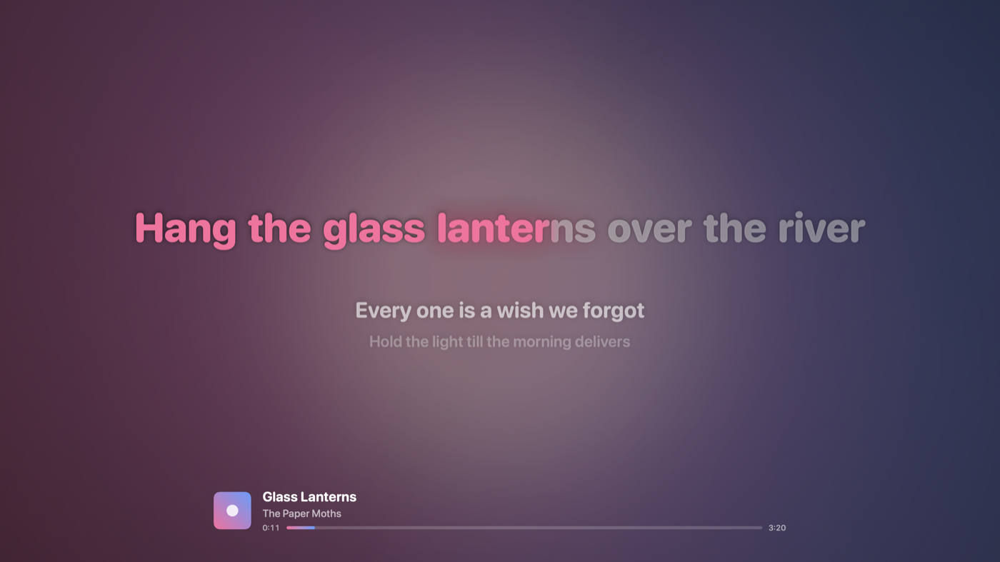
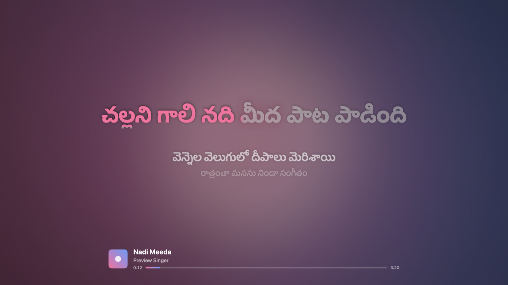

<p align="center"></p>

# YTM Glow

A personal macOS menu bar app that turns what's playing in **YouTube Music**
into light and lyrics:

- **Edge glow** — soft ambient light around the edges of every display, in the
  album art's colors (a two-color gradient). It pulses with the beat or holds a
  steady glow. Click-through, on every Space, above full-screen apps.
- **Synced lyrics** — the current line on screen with its words lighting up one
  at a time, in three styles: **Beam** (one big line above the Dock),
  **Cascade** (previous / current / next on a frosted card) and **Capsule** (a
  compact pill under the menu bar), with three animations: **Light up**,
  **Pop** (the sung word springs up; new lines rise in word by word) and
  **Karaoke** (color sweeps through each word as it's sung).
- **Beat visualizer for songs without lyrics** — when a song has no synced
  lyrics (instrumental, not on LRCLIB, or lyrics offline), mirrored equalizer
  bars in the album colors pulse with the bass, mids and highs where the lyrics
  would be, on the overlay, the karaoke screen (with the album art beating
  along) and the lock-screen card.
- **Telugu, Hindi, Tamil and other Indian songs** — lyrics in తెలుగు,
  हिन्दी, தமிழ், ಕನ್ನಡ, മലയാളം and other scripts or romanized, with the right
  language version picked for film songs released in several languages (see
  [Indian songs](#indian-songs-telugu-hindi-tamil)).
- **Karaoke screen** — a full-screen karaoke view on your second display:
  huge lyrics with a word-by-word color sweep, the next two lines underneath,
  a countdown through instrumental breaks, blurred album art that blooms on the
  beat, and the track's progress.
- **Menu bar only** — no Dock icon; one popover holds every setting.
- **Experimental: lock screen** — optionally keeps the glow and a now-playing
  lyrics card visible over the lock screen (private macOS APIs, off by
  default; see [docs/LOCK_SCREEN.md](docs/LOCK_SCREEN.md)), plus an option to
  keep the display awake while music plays.

YouTube Music runs in the browser, so a small Chrome extension (works in
Chrome, Brave, Edge and Arc) reports what's playing to the app over a local
WebSocket. Nothing leaves your Mac except lyric lookups (LRCLIB) and album-art
downloads (Google's image hosts).

Requires macOS 14 or later on Apple silicon. Not affiliated with YouTube or Google.

| Edge glow (album colors) | Settings popover |
|---|---|
|  |  |

Lyrics styles: **Beam**, **Cascade**, **Capsule**. The current word glows and the words already sung stay lit:





Animations: **Pop** lifts the word being sung; **Karaoke** sweeps color through it.


No lyrics? The beat visualizer takes their place:




The karaoke screen on a second display:



<sub>Rendered offscreen by the app itself (`YTMGlow --render-previews <dir>`) with sample lyrics, so they're real views, not mockups.</sub>

## Build the app

You need Xcode 15+ (or a Swift 5.9+ toolchain with the macOS SDK).

```sh
git clone https://github.com/SaandeepB/YTM-Glow.git
cd YTM-Glow
scripts/build-app.sh            # → build/YTM Glow.app (release, ad-hoc signed)
open "build/YTM Glow.app"
```

Optionally drag `build/YTM Glow.app` to `/Applications`. Because it's ad-hoc
signed (not notarized), the first launch from Finder may need right-click →
**Open**.

For development, `swift run YTMGlow` runs the app without bundling.

## Load the browser extension

1. Click the YTM Glow menu bar icon → **Browser extension…**. This copies the
   extension to `~/Library/Application Support/YTMGlow/ChromeExtension` and
   shows it in Finder. (Or use the `extension/` folder of this repo.)
2. Open `chrome://extensions` (or `brave://extensions`, `edge://extensions`,
   Arc → Extensions → Manage), turn on **Developer mode**.
3. Click **Load unpacked** and choose that folder.
4. Reload any open music.youtube.com tabs and play something.
5. Click once anywhere in the YouTube Music tab. Browsers only allow the beat
   tap after a user gesture; until then the glow is steady.

The extension's toolbar popup shows whether it's connected to the app.

## Use

Click the menu bar icon:

- **Edge glow**: on/off, *Music sync* vs *Steady*, thickness, intensity,
  album-art vs custom colors (two color wells).
- **Lyrics**: on/off, style (Beam / Cascade / Capsule), animation (Light up /
  Pop / Karaoke), album-art vs custom highlight color, size, a timing offset
  (+ shows lyrics later), *Script* (Any / English letters / తెలుగు / हिन्दी /
  தமிழ் / …), *Beat animation when there are no lyrics* (on by default), and
  *Keep display awake while playing*.
- **Karaoke screen**: on/off and which display (*Automatic* = the first display
  without the menu bar; with only one display it stays off unless you pick
  it). It opens while music plays, stays through pauses up to 30 s, and closes
  when the music stops. Press **Esc** (click it first) or the **×** to close.
  It never takes keyboard focus on its own.
- **Show on lock screen** (experimental, private API).
- **Open at login** (uses `SMAppService`; macOS may ask you to allow it in
  System Settings → General → Login Items, and the popover links there).
- **Browser extension…** and **Quit**.

The popover also shows the current track, whether synced lyrics were found,
and whether beat sync is active.

## How it works

```
music.youtube.com tab                    Chrome extension                     YTM Glow.app
┌──────────────────────────┐   port    ┌──────────────────────┐  WebSocket  ┌──────────────────────────┐
│ content.js               │ ────────▶ │ background.js        │ ──────────▶ │ BridgeServer 127.0.0.1   │
│  mediaSession.metadata   │  state    │ (service worker)     │  JSON       │ PlayerEngine             │
│  <video> position/paused │  2×/s     │  one socket, retries │  ws://127.  │  ├ LyricsService ─▶ LRCLIB│
│  Web Audio analyser      │  levels   │  with backoff        │  0.0.1:47816│  ├ ArtworkLoader ─▶ palette│
│   (pass-through)         │  ~30×/s   │                      │             │  ├ GlowController (CA)   │
└──────────────────────────┘           └──────────────────────┘             │  └ LyricsPresenter (UI)  │
                                                                            └──────────────────────────┘
```

- **Playback**: the content script reads `navigator.mediaSession.metadata`
  (title, artist, album, artwork) and the page's `<video>` (position, duration,
  paused, rate). It sends the full state about twice a second and immediately on
  play, pause, seek, rate and track changes. The app extrapolates the position
  between reports.
- **Beat**: after the first click in the tab, the content script routes the
  `<video>` through a Web Audio `AnalyserNode` and straight back out to the
  speakers, unchanged. It never mutes or alters playback; it only taps
  same-origin (MSE `blob:`) media, because routing cross-origin media into Web
  Audio would silence it, and it never routes audio into a suspended context.
  If the tap can't be created the glow falls back to steady. Levels are only
  measured while the app asks for them: music-sync glow, the karaoke screen,
  or the beat visualizer for a song without lyrics. Otherwise the extension
  doesn't analyse audio at all.
- **Bridge**: the service worker keeps one WebSocket to `ws://127.0.0.1:47816`
  and reconnects with backoff (0.5 s → 5 s) while a YouTube Music tab is open.
  The message format is documented in [docs/PROTOCOL.md](docs/PROTOCOL.md), so
  other players can plug in.
- **Glow**: four thin, borderless, click-through strip windows per display
  (above full-screen apps, on all Spaces). Core Animation draws the gradient
  once; beats only change the windows' alpha, which WindowServer applies while
  compositing, capped at 24 updates a second. When nothing plays the windows
  are ordered out, so the app idles at 0 % CPU.
- **Lyrics**: fetched from [LRCLIB](https://lrclib.net) (free, no key) and cached
  on disk in `~/Library/Caches/YTMGlow/lyrics`. Titles and artists are cleaned
  first (drops "(Official Video)", "feat. …", "- Topic", "VEVO", release
  notes like "- Remastered 2011"). The app tries `/api/get` (exact match, then
  without album, then with only the first artist), then `/api/search` and picks
  the closest duration with synced lyrics (±10 s). It retries once after 1 s on
  HTTP 503. Misses are re-checked after 3 days.
- **Album colors**: artwork is downloaded only from `https` hosts the player
  uses (`*.googleusercontent.com`, `*.ytimg.com`, `*.ggpht.com`, redirects
  included) and the two colors are extracted locally.

### Indian songs (Telugu, Hindi, Tamil…)

LRCLIB has synced lyrics for most popular Indian film songs. Each song may
exist in the original script (తెలుగు, हिन्दी, தமிழ்…), romanized in English
letters, or both. YTM Glow handles the extra wrinkles:

- **Right language version.** Pan-Indian films release the same song in
  several languages with the same title and singer, and LRCLIB entries are
  sometimes filed under the wrong album. In testing, every top result for the
  Telugu "Srivalli" was the Tamil version. The app reads the language from
  YouTube Music's metadata (e.g. "Pushpa - The Rise (Telugu)"). It checks each
  candidate's script and never shows another language's version. If needed it
  searches further ("Srivalli Telugu", "Srivalli Pushpa") to find the right
  one. If none exists, the beat visualizer shows instead of wrong lyrics.
- **Lyrics script setting.** Popover → Lyrics → *Script*. Choose తెలుగు (or
  हिन्दी, தமிழ், ಕನ್ನಡ, മലയാളം…) to prefer lyrics in that script, or *English
  letters* for romanized lyrics. It falls back to the other writing if that's
  all there is. Picking your language also helps when YouTube Music's metadata
  doesn't name the language.
- **Film-song titles are cleaned up.** `(From "Movie")`, `(Telugu Version)`,
  "Lyrical", "Full Video Song" and `Song | Movie | Actor` are removed before
  searching.
- **Word timing for Indian scripts.** Each akshara (syllable cluster) gets a
  beat, and a dead consonant (virama / pulli) gets half a beat. Romanized
  lyrics keep their sung final "e" ("suttukunte").

Verified live against LRCLIB: Srivalli (Telugu), Naatu Naatu, Samajavaragamana
and Chuttamalle all come back in Telugu script or romanized, never in another
language's script. To re-run: `YTMGLOW_LIVE_LRCLIB=1 swift test --filter
LiveIndianLyricsTests`.



### Word timing is estimated

LRCLIB lyrics are timed per **line**, not per word. YTM Glow estimates when
each word is sung: every word gets a share of the line weighted by its
syllable count (vowel groups for Latin, Cyrillic and Greek script, one per
Hangul block, one per Chinese/Japanese character), sung at a natural pace and
not stretched across instrumental gaps. So the highlight follows the line
closely but individual words can be early or late. If a lyric file carries
real word timestamps (enhanced LRC `<mm:ss.xx>` tags), those are used instead.
Use the timing offset if a whole song runs early or late.

## Privacy and security

- The app listens on **127.0.0.1 only** (verified: connecting via the LAN IP
  is refused).
- Browsers send an `Origin` header on WebSocket handshakes and WebSockets
  aren't covered by CORS, so the app refuses any handshake from a web page
  origin. Only extensions and native clients can connect.
- The extension asks for one permission (`storage`, for the port setting) and
  only runs on `https://music.youtube.com/*`.
- No macOS permissions: no Screen Recording, Microphone or Accessibility.
  It doesn't use the private MediaRemote / Now Playing APIs.
- The only private API is the optional lock-screen display (SkyLight), and it
  is never called unless you turn that option on.
- Chrome's Local Network Access rules don't block the extension:
  the WebSocket is opened from the extension's service worker, and the
  automated test connects without a prompt in Chromium 156.

## Performance

Measured on an Apple silicon Mac with **two 5K displays**, music sync on, Beam
lyrics, 120 BPM test track (Activity Monitor-style `top` samples):

| | YTM Glow CPU | WindowServer CPU |
|---|---|---|
| Nothing playing | 0.0 % | baseline |
| Playing (glow + lyrics) | ~1.3 % | +6 to +16 points over baseline |
| Playing, glow only | ~1.1 % | — |
| Playing, lyrics only | ~1.1 % | — |

WindowServer cost comes from recompositing the screen edges on each beat
update; *Steady* mode avoids it. It scales with display size and count, so
expect less on a single built-in display.

## Testing

```sh
swift build
swift test                                   # 68 Swift tests: parser, timing, cleanup,
                                             # palette, protocol, LRCLIB client, cache,
                                             # and a loopback WebSocket integration suite

cd extension-tests
npm test                                     # extension unit tests (Node, no install needed)
npm install && npx playwright install chromium
npm run test:e2e                             # loads the unpacked extension in Chromium against
                                             # a mock YouTube Music page and a fake app server
node demo/demo.mjs --headed                  # drives the real app with a fake player
                                             # posing as a real song (real lyrics + colors)
```

CI (GitHub Actions, macOS) runs `swift build`, `swift test`, the extension unit
tests and the app bundle build. The Playwright tests run locally.

What automation can't cover (real YouTube Music, multiple displays,
full-screen apps, sleep/wake, lock screen) is in
[docs/MANUAL_QA.md](docs/MANUAL_QA.md).

## Not yet verified

- Real music.youtube.com in a real browser. The extension is tested against a
  mock page that imitates YouTube Music's `mediaSession` and `<video>`, and
  the full app is tested end to end with that mock. If YouTube Music changes how
  it exposes playback, the content script may need an update.
- Glow above full-screen apps, multiple-display hot-plug, sleep/wake, and the
  look of each lyrics style. These need eyes on a screen; see MANUAL_QA.md.
- Brave, Edge and Arc (only Chromium was automated).
- The lock-screen display on an actually locked screen (the private calls are
  verified to succeed; visibility needs a human). Step-by-step checks are in
  [docs/LOCK_SCREEN.md](docs/LOCK_SCREEN.md).

## Troubleshooting

- **Popover says "Bridge error"**: another program uses port 47816. Quit it, or
  pick a different port in the extension popup (Advanced) *and* the app (not
  yet configurable in the app).
- **"Waiting for browser"**: check the extension is loaded and enabled, and
  reload the YouTube Music tab.
- **Steady glow, "Click the YTM tab"**: click once inside the YouTube Music page.
- **Logs**: `log stream --level info --predicate 'subsystem == "io.github.saandeepb.ytmglow"'`

## Icons and previews

The app icon and extension icons are original artwork drawn in code:
`swift scripts/make-icon.swift` regenerates `Resources/AppIcon.icns`,
`docs/images/icon.png` and `extension/icons/`. The README screenshots come
from `swift build && .build/debug/YTMGlow --render-previews docs/images`.

## Layout

```
Sources/YTMGlowCore/   UI-free logic: bridge server + protocol, lyrics, palette, beat envelope, engine
Sources/YTMGlow/       menu bar app: overlays, popover, settings
Tests/YTMGlowCoreTests Swift Testing suites + fixtures
extension/             the unpacked Chrome extension (MV3)
extension-tests/       Node unit tests, Playwright e2e, demo script (kept out of extension/)
scripts/build-app.sh   builds and ad-hoc signs build/YTM Glow.app
scripts/make-icon.swift draws the app and extension icons
docs/                  PROTOCOL.md, MANUAL_QA.md, LOCK_SCREEN.md
```
